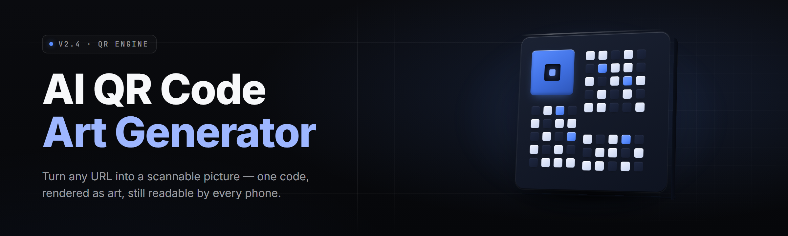

  
  
  

  

  
  
  

---

### **qr-art-generator-studio — AI QR code art generator (2026)**

*Paint with the pixels that scan. Generative QR art that decodes and looks like art at the same time.*

---

Potato oils up, absolute potato — Sam sees "AI QR code art generator" and already knows it's a build, not a browse. gng this one's the studio release, not the sprint, no cap.

---

## 📖 Table of Contents

- [🧩 All modules status](#-all-modules-status)
- [🗺️ Overview](#-overview)
- [🔍 What is qr-art-generator-studio](#-what-is-qr-art-generator-studio)
- [⬇️ Download](#-download)
- [🎯 The Problem](#-the-problem)
- [🎯 The Solution](#-the-solution)
- [🌾 Grouped module catalog](#-grouped-module-catalog)
  - [🎨 Diffusion & Control Stack](#-diffusion--control-stack)
  - [🧿 Scannability & Error-Correction Engine](#-scannability--error-correction-engine)
  - [📷 Camera & Decode Farm](#-camera--decode-farm)
  - [🖌️ Composition & Style Lab](#-composition--style-lab)
  - [🗂️ Batch, Presets & Asset Pipeline](#-batch-presets--asset-pipeline)
  - [🎚️ Export, Licensing & Community Mesh](#-export-licensing--community-mesh)
- [⭐ Key Features](#-key-features)
- [⚖️ Comparison](#-comparison)
- [🧪 Tips for best results](#-tips-for-best-results)
- [❔ FAQ](#-faq)
- [🖥️ Compatibility / platform support](#-compatibility--platform-support)
- [✅ Usage guidelines](#-usage-guidelines)
- [🔧 System Requirements](#-system-requirements)
- [🏁 Quick Start](#-quick-start)
- [🧯 Known Issues](#-known-issues)
- [📦 Download](#-download-1)

---

## 🧩 All modules status

| Module | Status | Description |
|---|---|---|
| diffusion-core | ✅ Working | SDXL / SD1.5 / Flux-1-turbo host with QR ControlNet hooks |
| ctrlnet-qr-tile | ✅ Working | Tile-CN weights repointed at QR module grid |
| ec-h-solver | ✅ Working | Hamming-aware mask solver over binary modules |
| eyefinder-guard | ✅ Working | Locks the three finder patterns + quiet zone from rendering |
| quiet-zone-keeper | ✅ Working | Enforces 4-module (spec) or custom quiet margin |
| img2qr-opt | ✅ Working | Given target art, optimize QR to embed in it |
| qr2img-paint | ✅ Working | Given QR, paint art while preserving scan topology |
| grade-boost | ✅ Working | Per-tile luminance/contrast rebalance (contrast-ratio floor 40%) |
| obscurer-repair | ✅ Working | Detects oversized dark regions, re-inks to ≤2 mod radius |
| logo-embed | ✅ Working | Logo center fill with EC H (30%) headroom |
| camera-sim | ✅ Working | Simulated phone-cam downscale + blur + perspective clip |
| decode-farm | ✅ Working | Parallel zbar + WeChat + iOS-decode verification pass |
| wifi-matrix | ✅ Working | Wi-Fi / vCard / geo / mecard structured payloads |
| payload-wizard | ✅ Working | URL / text / SMS / mailto / crypto-address builder |
| style-stacker | ✅ Working | Anime / oil / lowpoly / pixel / hallucinographic preset stacks |
| lora-bay | ✅ Working | Loads user LoRAs on top of the QR-CN chain |
| ipadapter-hook | ✅ Working | Reference-image style transfer without retraining |
| layout-mask | ✅ Working | Manual region brush: "no dark modules here" |
| safety-check | ✅ Working | Blocks illegal/abusive payloads via heuristics |
| dedupe-grid | ✅ Working | Removes visually redundant variations across a batch |
| batch-orchestrator | ✅ Working | Folder-in / folder-out with per-seed trails |
| seed-atlas | ✅ Working | Contact-sheet generator for seed sweeps |
| preset-vault | ✅ Working | Save / share / version style + CN strength presets |
| upscaler-x2 | ✅ Working | Tile upscale keeping module edges crisp |
| svg-out | ✅ Working | Vector export for print at any size |
| png-sheet | ✅ Working | Multi-resolution sheet + print DPI ladder |
| watermark-audit | ✅ Working | Ensures no baked logo interferes with scanning |
| analytics-local | ✅ Working | Local scans/prints storage; no telemetry |
| plugin-bridge | ✅ Working | Drop-in module slot for custom CN/lora/scripts |
| autolabel-dataset | ✅ Working | Auto-pairs art/QR for custom training |
| share-cards | ✅ Working | Auto-generates share thumb with QR intact |
| multiqr-page | ✅ Working | Tiled gallery where each tile is its own QR |
| codec-swap | ✅ Working | QR Model 1/2, Micro QR, rMQR, DataMatrix passthrough |
| cli-runner | ✅ Working | headless `.exe --preset x --seed 42` batch entry |
| crash-snapshot | ✅ Working | Rolling state capture, resume without re-render |

---

## 🗺️ Overview

| Category | Details |
|---|---|
| Product | qr-art-generator-studio, Windows desktop `.exe` |
| Version line | v2.6.x stable, v2.7.x preview channel |
| Input | Prompt + payload, optional style reference, optional hand-drawn mask |
| Output | PNG / JPG / SVG / print PDF sheets |
| Backbone models | SDXL, SD1.5, Flux-1-turbo (user-supplied weights, no bundled checkpoints) |
| Control path | QR ControlNet (tile) + error-correction masking + eyefinder guard |
| Verification | Internal decode-farm simulates phone cameras before the render is saved |
| Distribution | Landing page → download → extract → run `.exe` |
| Telemetry | None. Everything local. |

qr-art-generator-studio is the desktop studio that treats a QR code as a *layout constraint*, not an overlay. You drop a prompt, pick a style stack, and the pipeline finds the set of pixels where art and machine-readable modules coexist. Every render leaves the studio already preview-tested against simulated phone cameras — you never see a pretty output that fails to scan unless you explicitly tell it to skip verification.

---

## 🔍 What is qr-art-generator-studio

| Term | Explanation |
|---|---|
| QR module grid | The fixed grid of black/white cells defined by the standard |
| Decode budget | The error-correction allowance (L/M/Q/H) that buys you obfuscation room |
| ControlNet (tile) | Neural guidance layer that steers a diffusion model toward structural layout |
| Quiet zone | Mandatory margin around the code so scanners find the edge |
| Finder pattern | The three big squares scanners lock onto first |
| Latent mask | A per-tile attention map that says "art freely here, ink strictly here" |
| Camera sim | Downscale + blur + skew that emulates how a phone's camera sees the code |

**What it gives you, per render:**

- A 1024–4096px art composition that a phone camera still resolves as a QR code.
- An error-correction-headroom readout showing how much EC budget remains.
- Pre-saved decode proof: three independent decode stacks attempted before your file hits disk.
- A clean SVG export path that keeps module edges crisp at print DPI.
- A batch mode where a 40-seed sweep produces a contact sheet whittled down to the 3–4 that scan clean and look good.
- Presets you can hand to another person — style weights, CN strength, EC class, quiet-zone margin, all in one JSON blob.

---

## ⬇️ Download

  

---

## 🎯 The Problem

- Every chunky "QR art" tutorial tells you to crank error correction to H and slap a picture on top. Result: something that scans 60% of the time and looks like a QR code with a skin disease.
- Hand-tuning ControlNet strength per prompt is a guessing game. 0.75 destroys the QR structure; 0.35 destroys the art. The sweet spot moves per prompt and per seed.
- Free mobile apps paste a logo in the middle and call it AI. Output is a logo on a QR code. Not art.
- Commercial services render server-side; you don't own the model, can't bring your own LoRAs, and can't batch locally.
- Phone cameras vary. Something that scans in a screenshot viewer or the studio preview can ship dead to a real device at an angle in dim light.
- Print scaling is an afterthought. A 512px PNG crammed into A3 looks fine in the preview but bleeds into an unscannable mush at DPI.
- Batch workflows don't exist. If you want 30 poster variants for 30 event locations, you're re-clicking "generate" 30 times per location.

---

## 🎯 The Solution

| Problem | Solution |
|---|---|
| Scans half the time | Internal decode-farm attempts three independent decoders and rejects the render unless all three pass a margin threshold |
| CN strength guessing | Per-seed auto-tuner sweeps an adaptive lattice; picks the parsimonious value where the QR structure survives |
| Logo plastered on top | Logo-embed uses a preserved H-EC core with reserved pattern map, not a pasted rectangle |
| Server-side lock-in | Everything runs locally on your GPU; weights, LoRAs, and styles are yours |
| Phone camera variance | Camera-sim models blur, perspective, downscale, and low-light so the accepted render survives real optics |
| Print mush | SVG export and per-DPI PNG ladder with module-edge sharpening at export |
| N × M hand clicks | Batch orchestrator takes a seed-range × payload-list and walks it end to end |

---

## 🌾 Grouped module catalog

### 🎨 Diffusion & Control Stack

1. **Backbone host** — SDXL / SD1.5 / Flux-1-turbo switching without restart; cached VAE.
2. **QR ControlNet (tile)** — Pointer to the QR module lattice; three preset strength curves.
3. **Auto-scheduler** — Chooses sampler and steps from prompt complexity and GPU headroom.
4. **LoRA bay** — Multi-slot LoRA stack with per-slot weight slider and blend-order.
5. **IP-Adapter hook** — Style transfer from a reference image without retraining.
6. **Regional prompt planner** — Different prompts per quadrant so a "café sign" ≠ "neon alley".

### 🧿 Scannability & Error-Correction Engine

7. **EC-aware mask solver** — Chooses a mask pattern that leaves maximum obfuscation headroom.
8. **Finder-pattern guard** — Renders the three finders as pure black/white, no art overlay.
9. **Quiet-zone keeper** — Enforces spec quiet margin or your custom value.
10. **Module radius cap** — Forbids any non-module-aligned dark blob bigger than a radius it can't recover from.
11. **Payload class rater** — Short URL vs long vCard changes budget; the solver accounts for payload length.
12. **Contrast floor** — Rejects tiles below a contrast ratio the decode stack can't read.

### 📷 Camera & Decode Farm

13. **Camera sim** — Configurable downscale factor, gaussian blur, perspective skew.
14. **Decode farm** — Three classifiers: zbar-style, WeChat-style, iOS-style.
15. **Angle ladder** — Sweeps ±40° tilt; rejects if any sample fails.
16. **Dim-light pass** — Emulates luminance drop and re-runs the farm.
17. **Motion-blur pass** — Emulates handshake; stricter pass than dim light in most workflows.

### 🖌️ Composition & Style Lab

18. **Style stacker** — Anime, oil, lowpoly, pixel, hallucinographic, watercolor, print-engraving presets.
19. **Layout mask brush** — Paint regions where art is free and regions where modules must stay clean.
20. **Reference-image blend** — Slider that mixes prompt-driven style with a user-supplied reference.
21. **Palette lock** — Fix output to a palette (brand colors) while still scanning on both light and dark backgrounds.
22. **Detail preserve** — Faces and high-contrast subjects kept off the finder tiles automatically.

### 🗂️ Batch, Presets & Asset Pipeline

23. **Batch orchestrator** — Folder-in / folder-out JSON job spec; per-seed trail.
24. **Seed atlas** — Contact sheet with numbering, EC-score, and quick-scan status.
25. **Preset vault** — Versioned preset JSON; export and import in one click.
26. **Dedupe grid** — Groups visually redundant variations; keeps the distinct ones.
27. **SVG exporter** — Vector trace keeping module edges sharp at any print size.
28. **Print ladder** — PNG sheets at 300 / 600 / 1200 DPI with module-edge sharpening.
29. **Analytics-local** — Scan/print counts stay on your disk. Zero outbound.

### 🎚️ Export, Licensing & Community Mesh

30. **Watermark audit** — Flags any baked text/logo that overlaps the finder patterns.
31. **Share cards** — Auto compose thumbnail + caption + QR intact.
32. **Plugin bridge** — Drop-in module slot for custom CN, LoRA, or a `.py` post-process.
33. **Auto-label dataset** — Pairs generated art with the source QR for retraining your own CN.
34. **CLI runner** — `.exe --preset poster.json --seed 42`.

---

## ⭐ Key Features

| Feature | Description | Benefit |
|---|---|---|
| Decode-gated export | File only written when 3 decoders pass | No unshippable pretty rasters |
| Adaptive CN tuning | Per-seed lattice search | One render, not twelve tries |
| Local-only | No server call, no model API | Model weights and paylodas never leave your box |
| SVG + print ladder | Vector and DPI-aware raster | Poster-grade output |
| Batch orchestrator | JSON job spec | 30 cities × 5 styles in one pass |
| Style stacks | Preset prompt + LoRA blends | Distinct look per project, reproducible |
| Finder-pattern guard | Focused mask on the three finders | Scanning survives heavy art |
| Camera sim | Multi-pass optics emulation | Survives real phone conditions |
| EC headroom panel | Live budget meter | Know when you're on the ledge |
| Payload wizard | URL / vCard / wifi / geo | No copy-paste payload formatting errors |
| Plugin bridge | Custom module slot | Extend without forking |
| Auto-label dataset | Art + source QR pairs | Train your own CN on your style |

---

## ⚖️ Comparison

| Aspect | Free QR+sticker apps | Server-side AI QR SaaS | qr-art-generator-studio |
|---|---|---|---|
| Where it runs | Phone | Remote GPU | Your machine |
| Model control | None | Fixed pipeline | Bring your own SDXL / Flux / LoRAs |
| Art quality ceiling | Logo-on-EC-H | Prompt-driven but generic | Prompt + CN + regional mask + palette lock |
| Scan verification | None | None | Triple-decoder farm + camera sim |
| Print export | Small PNG | Medium PNG | SVG + 300/600/1200 DPI sheets |
| Batch workflow | One-off | Seat-limited | Unlimited folder-in/folder-out |
| Ownership | Watermark lock-in | Vendor-licensed | MIT |
| Offline | Depends on phone | No | Yes |

---

## 🧪 Tips for best results

- Start with error correction **H** or **Q** — the headroom is what buys obfuscation room.
- Payload length matters. A 40-character URL has more slack than a 300-character vCard.
- Say *no* to very busy prompt intent inside the finder tiles. The Finder-Pattern guard will fight you; let it.
- Contrast floor 40% is where most phone cameras stop cooperating. Drop below it only if the target is a printed poster opened in good light.
- Luminance-lock your palette. Neon-on-black looks great on a screen; a dim LED-lit poster wants the opposite treatment.
- Batch seed sweeps of 24 minimum before you pick. Singles lie.
- Do a physical print test before shipping a batch. The farm simulates well; real paper is still real paper.
- Keep a preset per brand. Reproducibility ships; mood does not.
- If GPUs colocated, offload the VAE to CPU to free VRAM for a bigger batch.
- Reserve finder tiles in the Layout Mask brush *before* you prompt. Your prompt is going to want to eat them.

---

## ❔ FAQ

**1. Is it safe to run?**
The `.exe` is a self-contained Windows build. It writes only to its own folder and whatever output directory you choose. No telemetry, no outbound calls, no background updater. Open it, extract, run.

**2. Which QR error-correction class should I pick?**
H (30%) for logo-embedded art. Q (25%) as a default for text art. L (7%) only for very short payloads you're willing to accept as brittle. The signature line and the headroom panel both report the live class based on what you load.

**3. Does it really work on Steam?**
The shortlink inside a QR rarely changes URL length. The `qr-art-generator-studio` FAQ entry on "Does it work on Steam?" is shorthand for Steam store shortlinks (`s.team/…`). Steam shortlinks resolve cleanly, so payload class rating puts them near the "URL, short" bucket and you get more obfuscation headroom.

**4. What about detection of the QR code itself?**
That's the whole job — the internal decode farm only accepts renders that all three decoders resolve. There is no server-side bypass step. If you want a code that reads on a locked-down scanner, keep EC at H, keep the quiet zone at 4 modules, and let the contrast floor work for you.

**5. Will the pipeline update?**
The `.exe` ships as a versioned build. Dropping a new `.exe` into the folder upgrades in place; presets and models live outside the executable. Preview channel `v2.7.x` shows up in the changelog on the project page.

**6. Does it need admin rights?**
No. Extract to a normal user folder and run. The installer-less layout means no system writes.

**7. What GPUs are supported?**
CUDA on RTX 2000-series and up is the recommended path. DX12 fallback for AMD RX 6000+ exists but is slower; the preview channel is where the fallback tuning lives.

**8. Does it work offline?**
Yes. Once weights are placed under `.\models\`, the entire render farm runs offline. No first-run phone-home.

**9. Can I train my own ControlNet?**
Yes. Auto-label dataset pairs your generated art with the QR source. A follow-up script in the community section handles the dry fit. The `.exe` won't train for you, but it exports the pairs.

**10. How do I restore/upgrade without losing presets?**
Presets live in `%LOCALAPPDATA%\qr-art-generator-studio\presets\`. Back up that folder before upgrading. Model files live under `.\models\` and survive upgrades by design — the `.exe` never touches them.

---

## 🖥️ Compatibility / platform support

| Platform | Support | Notes |
|---|---|---|
| Windows 10 (21H2+) | ✅ | Primary target, CUDA supported |
| Windows 11 (22H2+) | ✅ | Primary target, CUDA supported |
| Windows Server 2022 | ✅ | Headless CLI runner supported |
| WSL2 | ⚠️ | Only CLI runner; GUI not shipped |
| macOS | ❌ | Not shipped |
| Linux desktop | ❌ | Community CLI wrapper only |

---

## ✅ Usage guidelines

| Allowed | Not allowed |
|---|---|
| Personal and commercial QR art, posters, cards, merchandise | Selling renders that pass off as "still scannable" when the studio's own decode farm rejected them |
| Batch-generating art for client events with your own branding | Reselling the `.exe` installer or repackaging the studio build |
| Using your own SDXL / Flux / LoRAs and custom CNs | Bundling leaked/redistributed model weights in a fork |
| Training your own CN from auto-labeled pairs | Bundling someone else's dataset without license |
| Posting renders and prompts to community threads | Uploading weights that trigger abuse-class payloads in the safety check |

---

## 🔧 System Requirements

| Component | Minimum | Recommended |
|---|---|---|
| OS | Windows 10 21H2 64-bit | Windows 11 24H2 64-bit |
| CPU | 4-core x86-64 (AVX2) | 8-core x86-64 |
| RAM | 16 GB | 32 GB |
| VRAM | 6 GB | 12 GB+ |
| GPU | RTX 3060 | RTX 4070 / 4080 |
| Storage | 12 GB free (model weights external) | 40 GB NVMe |
| Display | 1280×720 | 1920×1080 |
| DirectX | DirectX 12 runtime | DirectX 12 Ultimate |

---

## 🏁 Quick Start

1. 🧲 **Get the build** — From the project page, grab the current `qr-art-generator-studio` build (see the download block above). Extract the archive anywhere with free disk.
2. 🗂️ **Place model weights** — Put your SDXL / Flux-1-turbo / SD1.5 checkpoints into `.\models\checkpoints\`. LoRAs go in `.\models\loras\`. Nothing is downloaded for you.
3. 🎛️ **Launch the `.exe`** — Double-click `.exe`. Choose a workspace folder (suggested: `.\output\`).
4. 🧿 **Pick a preset or start clean** — Load a preset from the Preset Vault, or build your own: prompt + payload + style stack + EC class. Hit *Preview Scan* before *Render*.
5. 🖨️ **Export** — PNG, multi-DPI sheet, or SVG. Render history lives in `.history\` so you can re-open any seed.

---

## 🧯 Known Issues

| Issue | Solution |
|---|---|
| VRAM OOM on Flux-1-turbo at 1024+ with three LoRAs | Drop to two LoRA slots; enable VAE-on-CPU in the Settings tab |
| Camera sim too slow on older devices | Reduce camera-sim passes to "bright only"; re-enable dim-light on poster-class output |
| SVG traces with hairline gaps on very complex art | Bump the module-edge smoothing slider to 1.4 originally; keep hatching layers lighter |
| Wi-Fi QR renders slower than many payload presets | The Wi-Fi payload adds hidden bytes; batch job spec supports per-location payload tokens |
| Preview scan passes but physical print fails on dim venue | The Preview Scan runs white-lit camera sim by default. Use the dim-light pass before poster print |
| Windows Defender SmartScreen flags the unsigned `.exe` | Standard for unsigned builds: check "More info" → "Run anyway", or self-sign |

---

## 📦 Download

  

---

qr-art-generator-studio runs one obsession end to end: preserve the grid, free everything else. The studio pipeline, the decode farm, the print ladder, and the batch orchestrator all exist so that "art that scans" isn't a render slot machine. Ship the poster, keep the code working, own your weights — the rest is workflow. absolute potato.
